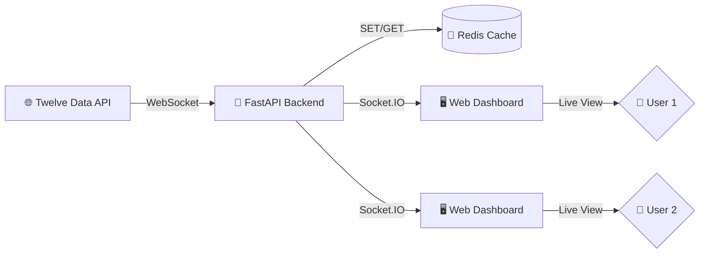

# 🏗️ Real-Time Forex Exchange Rate System

## Overview

بناء سيستم احترافي لعرض أسعار العملات الأجنبية (Forex) في الوقت الفعلي (Real-time)، يعتمد على:
- **Backend:** Python FastAPI + Socket.IO (Dockerized)
- **Data Source:** Twelve Data WebSocket API
- **Cache:** Redis (آخر سعر وصل)
- **Frontend:** Web Dashboard (HTML/CSS/JS) with Socket.IO client
- **Orchestration:** Docker Compose

---

## System Architecture



---

## Proposed Changes

### 1. Docker & Infrastructure

#### [NEW] [docker-compose.yml](file:///d:/hassan_charges/docker-compose.yml)
- **Redis service:** `redis:alpine` on port 6379
- **FastAPI service:** Built from `./backend/Dockerfile`
- **Web frontend service:** Nginx serving static files from `./frontend/`
- Environment variables for API key configuration
- Health checks for Redis

#### [NEW] [.env.example](file:///d:/hassan_charges/.env.example)
- `TWELVEDATA_API_KEY=your_api_key_here`
- `REDIS_URL=redis://redis:6379`
- `FOREX_PAIRS=EUR/USD,GBP/USD,USD/JPY,USD/EGP,USD/SAR,BTC/USD`

---

### 2. Backend (FastAPI + Socket.IO + Redis)

#### [NEW] [backend/Dockerfile](file:///d:/hassan_charges/backend/Dockerfile)
- Python 3.11 slim image
- Install dependencies from requirements.txt
- Run with uvicorn

#### [NEW] [backend/requirements.txt](file:///d:/hassan_charges/backend/requirements.txt)
```
fastapi==0.115.0
uvicorn[standard]==0.30.0
python-socketio==5.11.0
redis[hiredis]==5.0.0
twelvedata[websocket]==1.2.0
python-dotenv==1.0.0
aiohttp==3.9.0
```

#### [NEW] [backend/main.py](file:///d:/hassan_charges/backend/main.py)
Main application file containing:

1. **FastAPI + Socket.IO ASGI App Setup**
   - `socketio.AsyncServer(async_mode='asgi', cors_allowed_origins='*')`
   - `socketio.ASGIApp(sio, other_asgi_app=app)`

2. **Redis Connection Manager**
   - Async Redis client for storing/retrieving last prices
   - Key format: `forex:EUR/USD` → `{"symbol": "EUR/USD", "price": 1.0845, "timestamp": 1713600000, "change": 0.0012, "change_pct": 0.11}`

3. **Twelve Data WebSocket Consumer** (Background Task)
   - Connects to Twelve Data WebSocket on startup
   - Subscribes to configured forex pairs
   - On each price update:
     - Store in Redis (SET with JSON)
     - Broadcast to all Socket.IO clients via `sio.emit('price_update', data)`
   - **Debouncing:** 100ms throttle per symbol (لو السعر اتغير 20 مرة في الثانية)
   - Auto-reconnect on disconnect

4. **Socket.IO Event Handlers**
   - `@sio.on('connect')`: Send all cached prices from Redis immediately
   - `@sio.on('disconnect')`: Log disconnection
   - `@sio.on('subscribe')`: Allow clients to subscribe to specific pairs

5. **REST API Endpoints** (Fallback)
   - `GET /api/prices` → Return all cached prices from Redis
   - `GET /api/health` → Health check

#### [NEW] [backend/config.py](file:///d:/hassan_charges/backend/config.py)
- Environment variable parsing
- Default forex pairs configuration
- Redis URL, API key settings

---

### 3. Frontend (Web Dashboard)

> [!IMPORTANT]
> الـ User طلب "Web Application" مش Flutter. هنعمل Web Dashboard احترافي بتصميم Dark Theme شبيه بـ Binance/Thndr.

#### [NEW] [frontend/index.html](file:///d:/hassan_charges/frontend/index.html)
Structure:
- Navigation bar with logo and connection status indicator
- Main grid layout with currency pair cards
- Each card shows: Flag icons, Symbol, Price (large), Change %, Sparkline mini-chart
- Footer with data source attribution

#### [NEW] [frontend/css/style.css](file:///d:/hassan_charges/frontend/css/style.css)
Premium dark-themed design:

| Design Element | Implementation |
|:---|:---|
| **Background** | Deep charcoal gradient (`#0a0b10` → `#12141c`) |
| **Cards** | Glassmorphism (`backdrop-filter: blur(12px)`, semi-transparent) |
| **Bullish Color** | Bright Green `#00e676` |
| **Bearish Color** | Bright Red `#ff5252` |
| **Typography** | `Inter` for labels, `JetBrains Mono` for numbers |
| **Animations** | Price flash on update, smooth number transitions, pulse on connection |
| **Price Change** | Green glow for ↑, Red glow for ↓ with CSS transitions |
| **Responsive** | CSS Grid with `auto-fit` / `minmax` for mobile support |
| **Connection Status** | Animated dot (green = connected, red = disconnected) |

#### [NEW] [frontend/js/app.js](file:///d:/hassan_charges/frontend/js/app.js)
Client-side logic:

1. **Socket.IO Connection**
   - Connect to backend Socket.IO server
   - Listen for `price_update` events
   - Handle reconnection with exponential backoff

2. **Price Update Handler**
   - Update price value with animated number transition
   - Flash card border green/red on change
   - Update sparkline chart data point
   - Update change % and direction arrow

3. **Debouncing (Client-side)**
   - `requestAnimationFrame` for smooth DOM updates
   - Batch updates every 100ms to prevent UI jank

4. **Sparkline Charts**
   - Lightweight inline SVG sparklines (no heavy library)
   - Store last 60 data points per symbol
   - Auto-scroll with smooth animation

5. **Fallback**
   - If WebSocket disconnects, poll `GET /api/prices` every 5 seconds

#### [NEW] [frontend/nginx.conf](file:///d:/hassan_charges/frontend/nginx.conf)
- Serve static files
- Proxy `/socket.io/` to FastAPI backend
- WebSocket upgrade headers

---

### 4. Documentation

#### [NEW] [README.md](file:///d:/hassan_charges/README.md)
Full Arabic + English documentation covering:
- System Architecture diagram
- Prerequisites (Docker, API key)
- Quick Start guide (`docker-compose up`)
- Configuration options
- API endpoints reference
- How to add new currency pairs
- Troubleshooting guide

---

## 📂 Final File Structure

```
D:\hassan_charges\
├── docker-compose.yml
├── .env.example
├── .env                          (gitignored)
├── README.md
├── backend/
│   ├── Dockerfile
│   ├── requirements.txt
│   ├── main.py
│   └── config.py
└── frontend/
    ├── nginx.conf
    ├── Dockerfile
    ├── index.html
    ├── css/
    │   └── style.css
    └── js/
        └── app.js
```

---

## Open Questions

> [!IMPORTANT]
> ### 1. Twelve Data API Key
> هل عندك API Key من Twelve Data؟ لو لأ، هتحتاج تسجل مجاناً على [twelvedata.com](https://twelvedata.com) عشان تاخد مفتاح. الخطة المجانية بتديك 8 symbols WebSocket.

> [!IMPORTANT]
> ### 2. أزواج العملات المطلوبة
> الافتراضي هيكون:
> - `EUR/USD` (يورو/دولار)
> - `GBP/USD` (استرليني/دولار)
> - `USD/JPY` (دولار/ين)
> - `USD/EGP` (دولار/جنيه مصري)
> - `USD/SAR` (دولار/ريال سعودي)
> - `BTC/USD` (بيتكوين/دولار)
> 
> هل عايز أزواج تانية أو تعديل؟

> [!WARNING]
> ### 3. Demo Mode
> لو مش عايز تستخدم API حقيقي في البداية، ممكن أعمل **Demo Mode** بيعمل Simulate لأسعار وهمية بتتحدث كل ثانية عشان تشوف الشكل النهائي. هل تحب أبدأ بـ Demo Mode؟

---

## Verification Plan

### Automated Tests
1. `docker-compose up --build` → Verify all 3 services start
2. Open `http://localhost:3000` → Dashboard loads with dark theme
3. Verify Socket.IO connection (green status dot)
4. Verify price updates appear in real-time
5. Verify Redis caching: `docker exec redis redis-cli GET forex:EUR/USD`

### Browser Testing
- Open dashboard in browser and verify:
  - Cards render with glassmorphism effect
  - Prices flash green/red on change
  - Sparklines animate smoothly
  - Mobile responsive layout works
  - Connection status indicator works
